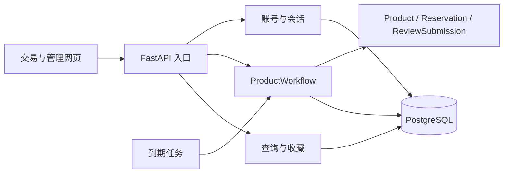

# 小蓝鲸二手集市实验三开发设计

实现基线为 `lab2-final`（`47c6035`）。领域方法、状态联动和事务约束沿用实验二设计。本阶段交付空库迁移、账号和会话入口。商品、审核、预约、查询和浏览器接入按以下设计推进。[实验二 UML 图解析](https://github.com/gggggg198/secondhand-trading-software/blob/47c6035a9b462cc585ae99645b512b27571f292d/%E5%AE%9E%E9%AA%8C%E4%BA%8C/UML%E5%9B%BE%E8%A7%A3%E6%9E%90.md)

## 应用边界

账号组件从 Cookie 查找服务端会话和当前账号权限。普通账号使用同一身份发布和预约商品。第一名管理员由命令行初始化，后续授撤权通过应用事务处理。初始化和后续授撤权使用同一个事务锁。授撤权在拿锁后重新检查操作者与目标，保护最后一名管理员，并与审计记录一起提交。

注册使用数据库中的小写用户名唯一键处理并发重名。密码使用 Argon2id 散列。会话使用随机 Cookie 值，数据库保存该值的摘要与失效时间。当前开发有效期为 12 小时，退出时删除对应会话。应用工厂启用 `Secure` Cookie，本地 `whale-market serve` 使用回环地址和 HTTP。部署到本机以外时使用 HTTPS。

## 数据模型

| UML 对象 | 数据库与实现约束 |
| --- | --- |
| `Account`、会话 | `account` 保存账号身份和当前权限，`account_session` 通过外键关联账号。首份迁移 `001_accounts.sql` 已建立两张表 |
| `Product`、`ProductImage` | 商品保存固定卖家、业务状态和版本。图片文件由上传入口校验，商品提交引用已校验文件 |
| `ReviewSubmission` | 送审时保存内容快照，一个商品至多有一笔待审提交。审核核对当前提交编号，只有符合发布时间规则的操作更新发布时间 |
| `Reservation` | 保存商品、买家、预约原价、交付地点与时间以及首次成交时间。卖家从商品关联取得，当前预约按有效状态查询。有效与完成预约分别通过部分唯一索引约束 |
| `OperationResult`、`AuditEntry` | 前者以账号、动作和提交标记唯一识别最终业务结果。后者保存业务变更和敏感读取记录。商品操作的成功审计和最终结果随业务提交 |
| `Favorite` | `(account_id, product_id)` 为联合主键。关注量按关系计数，收藏事务只写收藏关系 |

金额按 `Decimal` 与 PostgreSQL `NUMERIC` 传递，预约快照保留创建时价格。时间存储用 `TIMESTAMPTZ`，成交统计按北京时间的左闭右开区间查询首次完成时间。待确认预约的截止时间取创建后 24 小时和交付时间中的较早值。实际决策使用拿到商品锁后的服务端时间，等于截止时间即过期。

## 接口与事务

| 入口 | 当前约定 |
| --- | --- |
| `POST /api/auth/register`、`POST /api/auth/login` | 接收 `username`、`password`。注册成功返回普通账号，登录成功设置会话 Cookie。重名返回 `409`，输入校验返回 `422` |
| `GET /api/auth/me`、`POST /api/auth/logout` | 查询当前账号，或撤销 Cookie 对应的会话。会话失效后查询返回 `401` |
| `GET /api/products`、`POST /api/products` | 计划分别用于公开商品查询和创建草稿。组合筛选和分页在服务端执行 |
| `POST /api/products/{id}/reservations` | 计划用于创建预约。提交标记随请求携带，同时提供商品版本及交付约定 |
| 商品、预约和审核动作 | 后续路由从会话取操作者、从路径取对象编号、从请求取提交标记和版本。写入统一交由 `ProductWorkflow` |

1. **同次提交。** 先按操作者、动作及提交标记取得事务锁，再查找最终结果。比较记录中的规范化目标和业务参数，并重新核对结果的当前读取权限。同内容重试返回原结果，标记复用但内容变化时返回冲突。
2. **新命令。** 在同一事务锁住商品行，拿锁后重新读预约与审核，校验角色、关联关系、状态和版本。领域方法成功后将商品、相关记录、最终结果和成功审计一并保存。相关实际变更只递增一次商品版本。
3. **过期与恢复。** 创建预约或接受预约时发现到期，先结束原事务，再由 `expireIfDue` 独立释放。随后凭原提交标记与版本重新进入流程。提交结果未知时，客户端保留原标记以恢复结果。后台扫描也通过同一到期方法重新核对当前预约。

## 下一批验收

1. 补齐商品、图片和送审模型，做出草稿、提交、审核通过、公开查询的流程。提交校验前定下文字和图片限值口径、公开详情及筛选排序规则。[需求中的待确认事项](https://github.com/gggggg198/secondhand-trading-software/blob/47c6035a9b462cc585ae99645b512b27571f292d/%E5%AE%9E%E9%AA%8C%E4%B8%80/requirements.md#%E5%BE%85%E7%A1%AE%E8%AE%A4%E4%BA%8B%E9%A1%B9)
2. 在两个独立数据库连接下测预约竞争和下架竞争。再测同标记重放、提交前故障回滚、提交后响应丢失、到期边界及旧任务遇到后继预约。
3. 将实验二网页的账号、商品及预约操作逐步改为同源 HTTP 调用。用买家、卖家和管理员验证主链路及权限，后续补齐统计、审计和收藏相关验收。
